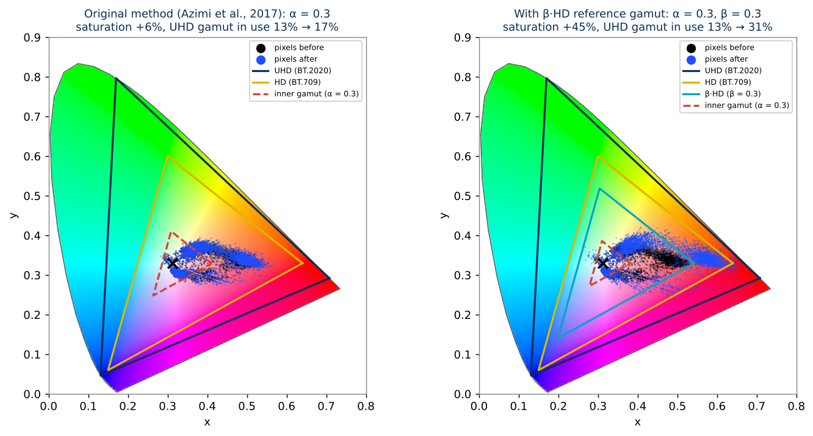
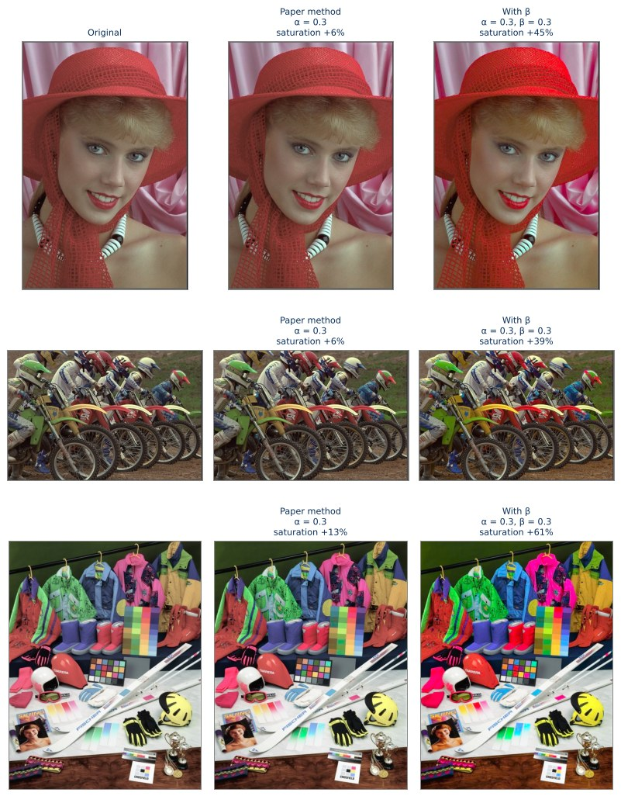
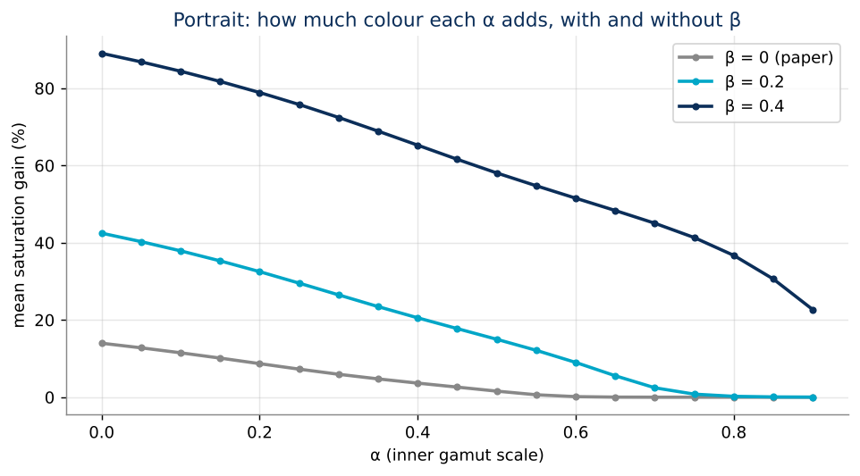
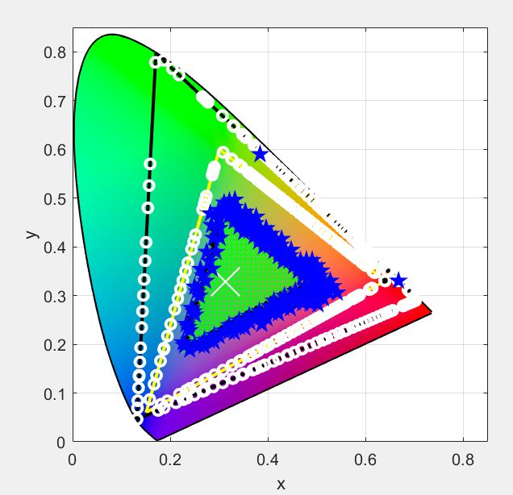
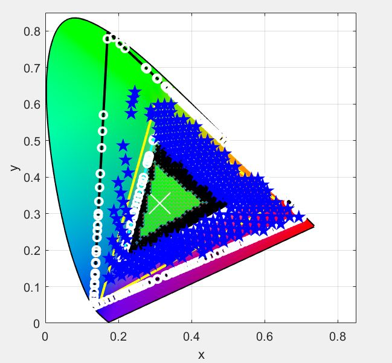

# Colour Gamut Expansion: making HD content use a UHD screen

Your TV is 4K/UHD and can show far more colour than HD, but most of what you watch is still mastered in HD.
The panel's extra colour range sits unused. This project expands HD colours outward into the UHD gamut,
evenly and without shifting hue, so the content actually uses the display it is shown on.

**[▶ Try the interactive demo](https://cyberdrk.github.io/projects/color-gamut-expansion/)**: drag α and β and watch the image and its chromaticity diagram change live.



## At a glance

- **Context:** International research internship, Imaging Systems Lab, Changwon National University, South Korea (May–Jul 2018), funded by the Government of South Korea and supervised by Prof. Oh-Seol Kwon.
- **Problem:** A published UHD gamut-expansion method (Azimi et al., IEEE ICC 2017) barely changes real images. Their colours sit close to the white point, so most of its α settings do nothing at all.
- **What I did:** Implemented the paper in MATLAB, diagnosed why it under-expands, and introduced a second scale factor, **β**, that fits the reference gamut to the image's own colours.
- **Result:** On the same setting (α = 0.3), saturation gain rose **from +6% to +45% (about 7.7×)** on a portrait, and the share of the UHD gamut the image uses more than doubled, **from 13% to 31%**.
- **Outcome:** Presented to the lab and Korean graduate students; a paper was submitted to *IET Electronics Letters* (2018).

## The problem

Every display can only show colours inside its **gamut**, a triangle on the CIE 1931 chromaticity diagram whose corners are its red, green and blue primaries.

| Standard | Used for | Area on the xy diagram |
| --- | --- | --- |
| ITU-R **BT.709** | HD content and displays | 0.112 |
| ITU-R **BT.2020** | UHD/4K content and displays | 0.212 (**1.9× larger**) |

When HD content plays on a UHD panel, its colours are shown exactly as mastered, inside the small BT.709 triangle.
Nearly half of the colour the panel can produce goes unused. **Gamut expansion** maps HD colours outward into
BT.2020 so the picture fills the display, while keeping each pixel's hue and brightness.

## How expansion works

Both methods work point by point in CIE 1931 xy chromaticity and keep luminance Y unchanged.
Each pixel moves along the straight line from the white point (D65) through its own colour,
the *Towards White Point* (TWP) projection, so its hue is preserved and only its saturation changes.

For a pixel at distance $x_m$ from the white point, measured along its own TWP line:

| Symbol | Meaning |
| --- | --- |
| $D$ | distance from the white point to the **UHD** (BT.2020) border |
| $d$ | distance from the white point to the **HD** (BT.709) border |
| $d_\alpha = \alpha \cdot d$ | border of an **inner gamut**, the HD gamut scaled towards white by α |

**Original method (Azimi et al., 2017).** Colours inside the inner gamut are left alone, which protects skin tones
and neutrals. Everything between the inner gamut and the HD border is stretched linearly out to the UHD border:

$$
x =
\begin{cases}
x_m + (D - d)\,\dfrac{x_m - d_\alpha}{d - d_\alpha}, & x_m > d_\alpha \\[6pt]
x_m, & \text{otherwise}
\end{cases}
$$

### Why it under-delivers on real images

Most natural images occupy a small cloud around the white point, far inside the HD triangle (the black cloud in the
left diagram above). Two things follow:

1. **Most α values are wasted.** Until α drops to about 0.6, almost no pixel lies outside the inner gamut, so nothing moves.
2. **The pixels that do move barely move.** The stretch is proportional to how far a pixel already is from the inner
   border, measured against the full HD distance $d$. Pixels near the white point get a tiny push.

### What I changed: a β·HD reference gamut

I introduced a second scale factor **β** that shrinks the reference HD gamut towards the white point, so it hugs the
image's actual colours. This **β·HD** gamut replaces the HD gamut in every calculation:

$$
d_\beta = (1 - \beta)\, d \qquad d_\alpha = \alpha \cdot d_\beta \qquad
x = x_m + (D - d_\beta)\,\frac{x_m - d_\alpha}{d_\beta - d_\alpha}
$$

- **β = 0** reproduces the original method exactly.
- Larger **β** gives a tighter reference gamut, so α becomes useful across its whole range, expansion is stronger,
  and the expanded colours are spread **more evenly** along each TWP line (blue cloud, right diagram).

## Results

Same α = 0.3 for both methods; numbers from [`python/gamut_expansion.py`](python/gamut_expansion.py).

| Image | Method | Pixels expanded | Mean saturation gain | UHD gamut in use |
| --- | --- | ---: | ---: | ---: |
| Portrait | Original (β = 0) | 66% | +6% | 13% → 17% |
| Portrait | **With β = 0.3** | **86%** | **+45%** | **13% → 31%** |
| Motocross | Original (β = 0) | 45% | +6% | 33% → 45% |
| Motocross | **With β = 0.3** | **63%** | **+39%** | **33% → 70%** |
| Ski scene | Original (β = 0) | 67% | +13% | 47% → 72% |
| Ski scene | **With β = 0.3** | **71%** | **+61%** | **47% → 96%** |

*Saturation gain* is the change in mean distance from the white point. *UHD gamut in use* is the share of
0.01 × 0.01 chromaticity cells inside BT.2020 that contain at least one pixel.



**α is no longer wasted.** With the original method, saturation gain is flat at zero for α ≥ 0.6. With β, every α adds colour:



> Colours beyond sRGB are clipped in these PNGs, the same as the original MATLAB output, so on a normal monitor
> they look a little stronger than on a true UHD panel. The [interactive demo](https://cyberdrk.github.io/projects/color-gamut-expansion/)
> renders in Display P3 when your screen supports it.

### From the 2018 lab notebook

Original MATLAB chromaticity plots from the internship. Yellow is HD, black is UHD, cyan is β·HD, red is the inner
gamut; black crosses are pixels before expansion and blue stars after.

| Without β | With β |
| --- | --- |
|  |  |

## Repository layout

```
MATLAB scripts/            original 2018 research code
  validPointEA.m           expansion with the original method (α)
  validbEAoriginal.m       expansion with the β·HD reference gamut (α, β)
  gamut_expansion.m        expansion formula (Eq. 2 of the paper)
  gamut_compression.m      compression formula (Eq. 1), UHD → HD
  readRGB.m, createRGB.m   sRGB ↔ CIE xyY conversion, keeping luminance
  ratio_longline.m, calc_distance.m, ...   TWP projection helpers
python/
  gamut_expansion.py       clean NumPy reference implementation and CLI
  make_figures.py          regenerates everything in docs/figures
images/test/               test images
docs/figures/              README figures (generated)
docs/2018/                 plots from the original MATLAB runs
```

## Run it

### Python (no MATLAB needed)

```bash
cd python
pip install -r requirements.txt

# β = 0 is the original paper; try β between 0.2 and 0.4 for small-gamut images
python gamut_expansion.py ../images/test/portrait.jpg out.png --alpha 0.3 --beta 0.3
# alpha=0.3 beta=0.3  pixels expanded 86.2%  saturation +45.2%  UHD gamut in use 13.5% → 31.4%

python make_figures.py   # rebuild the README figures
```

### MATLAB (original code)

Requires MATLAB R2017b or later with the Image Processing Toolbox (`rgb2xyz`, `plotChromaticity`) and the Mapping
Toolbox (`polyxpoly`).

1. Add `MATLAB scripts/` to the MATLAB path and create a `res/` folder for results.
2. Open `validPointEA.m` (original method) or `validbEAoriginal.m` (with β).
3. Set the image and parameters at the top of the script, then run:

   ```matlab
   image_name = 'portrait.png';
   alpha = 0.3;
   beta  = 0.3;   % validbEAoriginal.m only
   ```

4. Update the `imwrite`/`saveas` paths at the end of the script; they still point to the original lab machine.

## Notes

- **Colour space.** The paper performs the mapping in CIE LC\*h\*; this implementation, like the 2018 MATLAB code,
  works in CIE 1931 xy with luminance preserved, which keeps hue lines straight and the geometry easy to follow.
- **Colours beyond the β·HD border.** The stretch would push them past BT.2020, so they stop at the UHD border.
  The 2018 MATLAB script left them unexpanded instead.
- **Precision.** The MATLAB code rounds chromaticities to two decimals and processes unique colours for speed;
  the Python version works per pixel at full precision, so results differ slightly.

## References

- M. Azimi, T.-F. Bronner, P. Nasiopoulos and M. T. Pourazad, "[A Color Gamut Mapping Scheme for Backward
  Compatible UHD Video Distribution](https://ieeexplore.ieee.org/document/7996741)," *IEEE International
  Conference on Communications (ICC)*, 2017.
- ITU-R Recommendation BT.709 (HDTV) and BT.2020 (UHDTV).
- Research supervised by Prof. Oh-Seol Kwon, Imaging Systems Lab, Changwon National University.
- Test images: Kodak Lossless True Color Image Suite (portrait, motocross) and a standard ski-scene colour test image.
